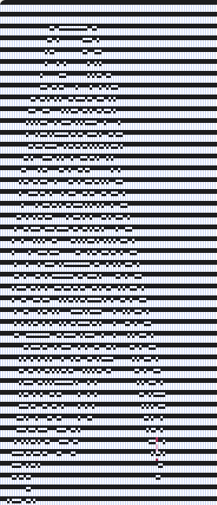
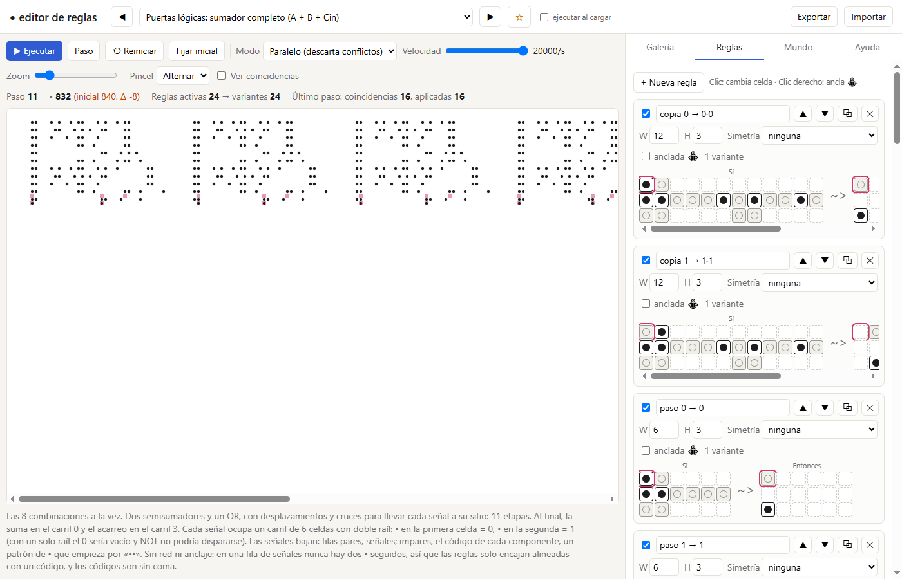
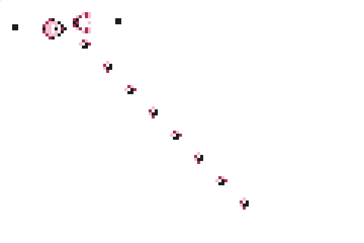
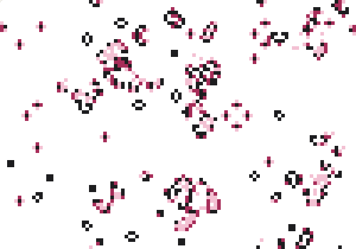
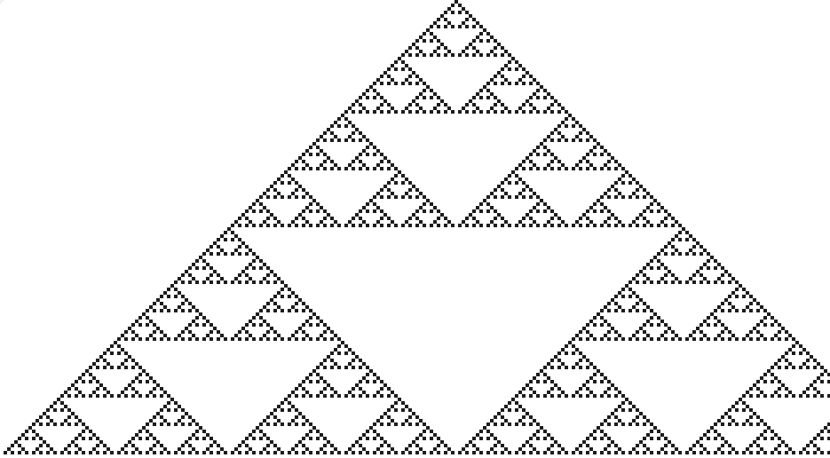
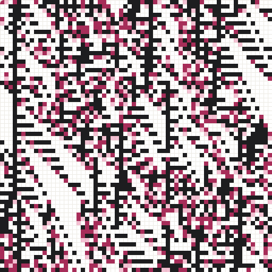

# • — editor de reglas

Editor web para experimentar con el lenguaje •. El mundo es una grilla donde cada celda es un píxel encendido (•) o apagado, y todo lo demás son reglas de la forma *disposición de celdas ~> disposición de celdas*.


## Cómo abrirlo

Abre `index.html` en el navegador; no hace falta instalar nada.

Para guardar los favoritos en `favoritos.json` (y no solo en el navegador), arranca el servidor local:

```
python servidor.py 8765
```

y entra en http://localhost:8765.

## Qué permite

- Encender y apagar píxeles con el ratón.
- Crear reglas con una condición («Si») y un resultado («Entonces»), de cualquier tamaño, con celdas «cualquiera».
- Generar automáticamente rotaciones y espejos de una regla.
- Anclar reglas a una red (rectangular o diagonal) cuando la posición de los bloques no se puede deducir de los propios •.
- Ejecutar en modo secuencial o paralelo, con distintas políticas de conflicto, de 0,5 a 20.000 pasos por segundo.
- Ver las coincidencias de cada regla y comprobar si el sistema conserva el número de •.
- Recorrer la galería de autómatas con ← →, filtrarla y marcar favoritos (★).
- Rellenar la grilla con un mosaico, y exportar o importar el estado completo en JSON.


## Galería

### Hormigas

- Hormiga de Langton con bloques de 6 celdas, que conserva los •.
- Hormiga en cruces de 5 celdas, con 2 reglas y simetría de rotación, y la versión con 8 reglas de 3 celdas.
- Hormiga sin red: el mundo empieza vacío y nada está anclado.
- Hormigas autolocalizables de 4, 5, 6 y 7 celdas: reglas sin anclaje que solo encajan en la posición real. Las generó la búsqueda de `busqueda/`.

| Autolocalizable que conserva los • (5 celdas) | Cruz anclada (5 celdas) |
|---|---|
|  |  |

### Puertas lógicas

AND, OR, XOR, NAND, NOR, XNOR y NOT como reglas, y con ellas un semisumador y un sumador completo. Cada ejemplo calcula todas las combinaciones de entradas a la vez.

- Cada señal baja por un carril de 6 celdas con **doble raíl**: • en la primera celda = 0 y • en la segunda = 1. Con un solo raíl el 0 sería vacío, y NOT no tendría nada con lo que dispararse.
- Las filas alternan señales y componentes. Cada componente (puerta, copia, cruce, desplazamiento) es un patrón de • que dice qué es, y cada combinación de entradas es una regla.
- Sin red ni anclaje. Todo código empieza por «••» y en una fila de señales nunca hay dos • seguidos, así que las reglas solo encajan alineadas con un código. En horizontal, los códigos forman un código sin coma.

| Tablas de verdad (de arriba abajo AND, OR, XOR, NAND, NOR, XNOR y NOT) | Sumador completo tras 11 etapas |
|---|---|
|  |  |

### Máquina de Turing universal

Un único juego de **65 reglas fijas** (924 celdas especificadas) ejecuta cualquier programa. El programa (la tabla de la máquina) y su cinta están escritos en • en el mundo, así que para cambiar de programa se cambian los •, no las reglas. Vienen cargados la suma unaria 3 + 2 y los busy beaver de 2, 3 y 4 estados. En la pestaña **Mundo** puedes escribir tu propio programa:

```
A: 1RB 1LB
B: 1LA 1RH
```

Cada línea es un estado, con la transición al leer 0 y al leer 1: escribe 0/1, mueve L/R y estado siguiente. `H` = parar.

- Cada columna es una casilla de la máquina universal, de 12 celdas: el símbolo (5 filas) y el estado del cabezal universal (7 filas: 2 encima y 5 debajo del símbolo; vacío = no está aquí). La casilla en blanco de la cinta es vacía, así que la cinta sigue por el mundo vacío.
- Los códigos de cada símbolo y estado, y las celdas que mira cada regla, salen de una búsqueda que minimiza las celdas especificadas (`busqueda/turing/`). La primera versión necesitaba 95 reglas y 2.185 celdas.
- A la izquierda está el programa: un bloque por estado, con la transición para 0 y para 1, y el número del estado siguiente en unario. A la derecha, la cinta simulada.
- En cada paso simulado, el cabezal universal hace lo siguiente:
  1. Lee la casilla.
  2. Busca el bloque del estado actual y la transición que toca.
  3. Escribe en la cinta y mueve el cabezal simulado.
  4. Cuenta las N del estado siguiente para marcar su bloque.
- Sin anclaje: en cada paso hay exactamente una coincidencia, y al parar el cabezal desaparece. Con anclaje bastarían 10 filas por casilla y 685 celdas.

| Programa | Pasos simulados | Pasos de la universal |
|---|---|---|
| Suma 3 + 2 | 8 | 1.412 |
| Busy beaver 2 | 6 | 679 |
| Busy beaver 3 | 14 | 3.394 |
| Busy beaver 4 | 107 | 36.951 |


### Máquinas de Turing en su mínima expresión

Una búsqueda exhaustiva en `busqueda/turing/` encuentra la forma más pequeña de escribir una máquina concreta en •: cuántas celdas por casilla y cuántas celdas especificadas en sus reglas. La cinta en blanco es el mundo vacío (infinita gratis) y el cabezal desaparece al parar.

| Máquina | Anclada | Sin anclaje | Versión anterior |
|---|---|---|---|
| Busy beaver 2 | 3 celdas por casilla, 17 celdas de reglas | 5 por casilla, 27 | 5 por casilla, 55 |
| Busy beaver 3 | 3, 34 | 5, 49 | 6, 84 |
| Busy beaver 4 | 4, 46 | 5, 77 | 6, 114 |

Anclada se alcanza la cota teórica ⌈log₂(símbolos · (estados + 1))⌉. Sin anclaje no hay ninguna codificación que se autolocalice con esa altura: hace falta al menos una fila más, que la búsqueda usa como «marca».

### Juego de la Vida de Conway

Las reglas de Conway escritas con las reglas normales del editor, sin tocar el motor: **26 reglas 3×3** con simetría (135 variantes) en modo paralelo. Cada regla mira una ventana 3×3 y solo cambia la celda del centro:

| Regla | Condición | Formas distintas |
|---|---|---|
| Nace | centro vacío y exactamente 3 vecinos (las 9 celdas especificadas) | 10 |
| Muere por soledad | centro encendido y 0 o 1 vecinos (las 9 especificadas) | 3 |
| Muere por exceso | centro encendido y 4 vecinos concretos encendidos (el resto «cualquiera») | 13 |

Sobrevivir con 2 o 3 vecinos no necesita regla: no cambia nada. Las formas son las clases de vecindarios salvo giros y espejos, y la simetría «all» genera el resto. El modo paralelo lee el estado anterior y escribe después, que es justo la generación síncrona de Conway. Con «exceso» varias reglas pueden encajar en la misma celda; todas escriben lo mismo, así que se usa «paralelo: gana la primera» (en «descarta conflictos» se anularían). Los conflictos que muestra el contador son esos y no afectan al resultado.

Ejemplos: planeador y nave ligera, púlsar, cañón de Gosper, R-pentominó y una sopa aleatoria.

| Cañón de Gosper (240 generaciones) | Sopa aleatoria (150 generaciones) |
|---|---|
|  |  |

### Clásicos

Gas de partículas, arena con gravedad y triángulo de Sierpinski (regla 90).



### Entropía y órdenes

Sistemas encontrados por fuerza bruta en `busqueda/entropia/` y clasificados por cómo cambia su entropía (de «baja» a «alta» y al revés) y por su comportamiento final.

- **Entropía · una regla**: el representante más corto de cada grupo.
- **Busy beaver**: para cada tamaño de regla, la que más entropía deja tras 128 pasos.
- **Órdenes · varias reglas**: sistemas de 2 a 16 reglas que mezclan reglas productivas, consumidoras y movedoras.

En rosa, las celdas que cambiaron en el último paso: oscuro si se encendieron, claro si se apagaron.




## Resultados

El informe [`informe_autolocalizacion.pdf`](informe_autolocalizacion.pdf) responde a una pregunta: ¿cuánto cuesta que la hormiga funcione sin red, es decir, que las reglas solo puedan encajar en la posición real?

| Familia | Anclada | Sin anclaje | Anclada y conserva • | Sin anclaje y conserva • |
|---|---|---|---|---|
| 10 patrones cualesquiera | 4 | 4 | 5 | 5 |
| Hormiga = un único • | 5 | 6 | 6 | 7 |

Con reglas que miran el bloque actual y el destino completos, no anclar sale gratis en general. Solo cuesta una celda si la hormiga debe ser un único •. Ojo: esto minimiza el tamaño del bloque, no el de las reglas.

## Estructura

| Ruta | Qué hay |
|---|---|
| `index.html`, `style.css`, `app.js` | Interfaz del editor |
| `engine.js` | Motor (también se usa desde Node) |
| `examples.js` | Ejemplos de la galería |
| `ganadores.js`, `sistemas.js`, `sistemas_multi.js` | Datos generados por los scripts de `busqueda/` |
| `logica.js` | Puertas lógicas: codificación, reglas y circuitos |
| `vida.js` | Juego de la Vida: reglas, patrones y referencia directa |
| `turing.js` | Máquina de Turing universal: tabla fija, compilación a reglas y codificación de programas |
| `servidor.py` | Servidor local sin caché, con la API de favoritos |
| `busqueda/` | Búsqueda de codificaciones autolocalizables (Python + numpy) |
| `busqueda/hormiga/` | Hormiga con el mínimo de reglas y hormiga sin red |
| `busqueda/entropia/` | Exploración de sistemas por entropía |
| `test/` | Pruebas en Node |

## Pruebas

```
node test/test.js
node test/autolocalizables.js
node test/logica.js
node test/turing.js
node test/vida.js
```

Comprueban que las hormigas reproducen paso a paso la hormiga clásica (autopista incluida), que las autolocalizables dan una sola coincidencia por paso sin anclaje, que Sierpinski coincide con la regla 90 y que los ejemplos conservativos conservan los •. La segunda tarda unos dos minutos. Las dos últimas comprueban todas las entradas de cada circuito y cada programa de la máquina universal contra su simulación directa, y que ninguna regla encaja fuera de su sitio. La de la máquina universal tarda unos 20 segundos. La del Juego de la Vida compara cada generación con una implementación directa de Conway.
