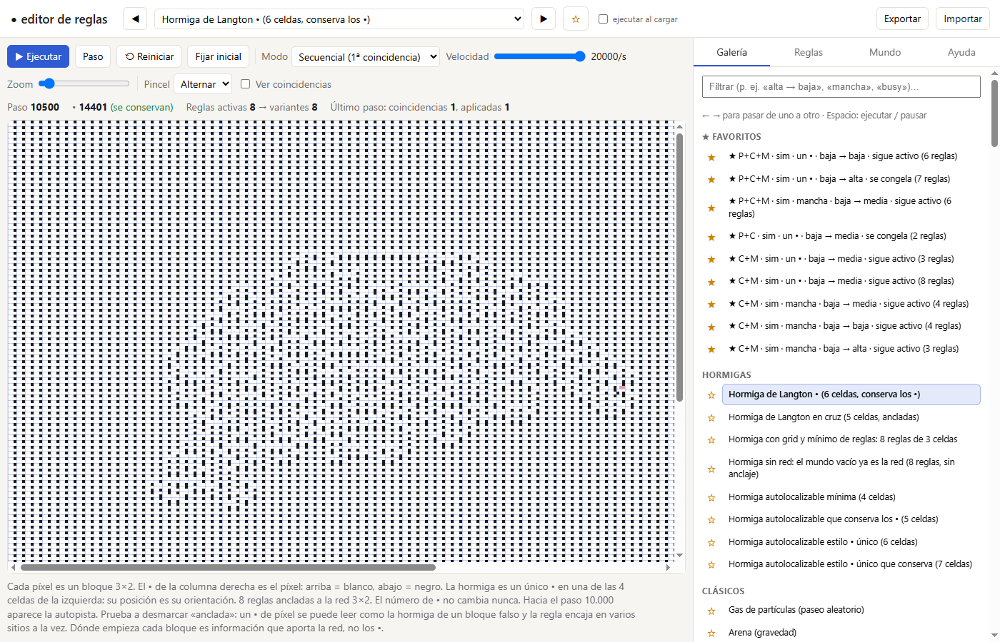
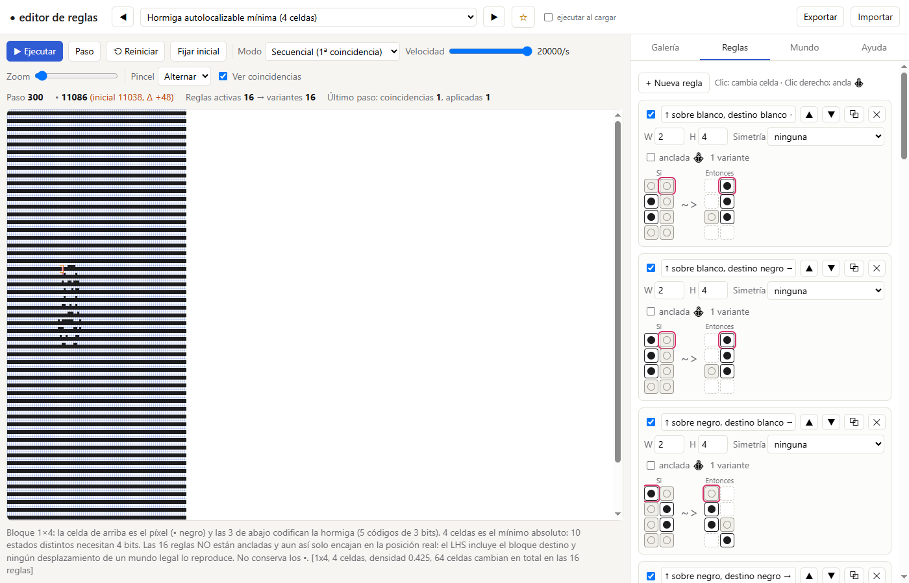
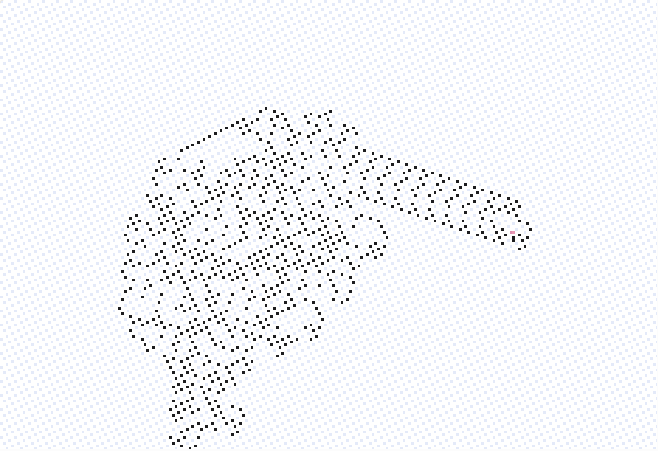
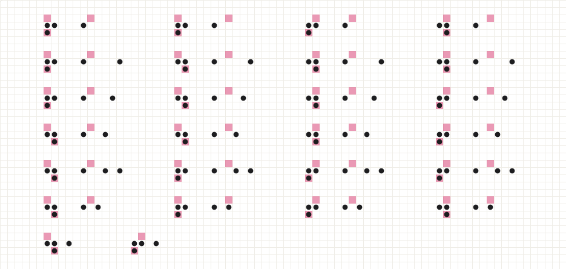
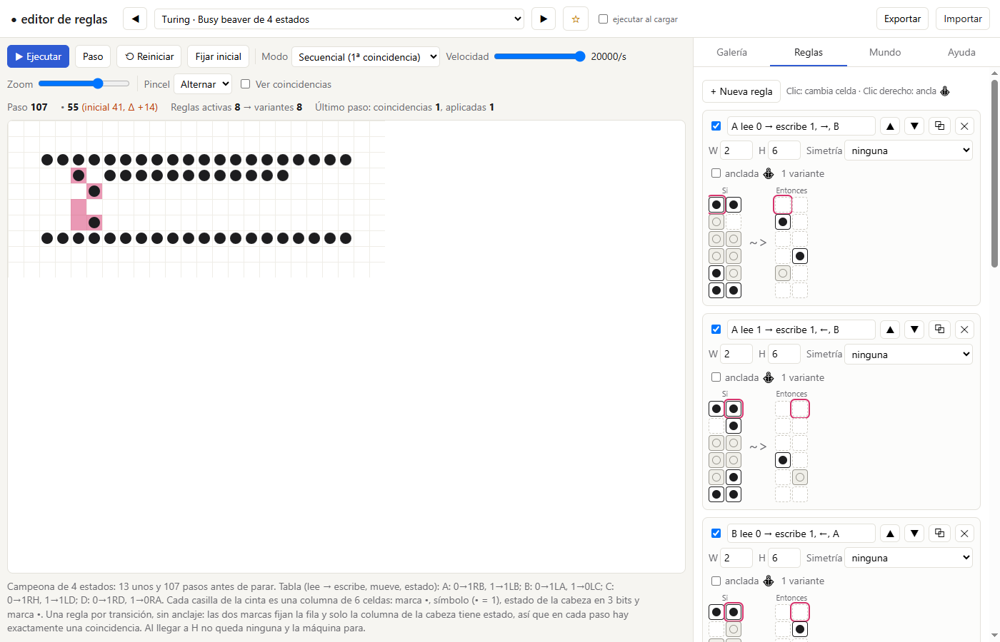
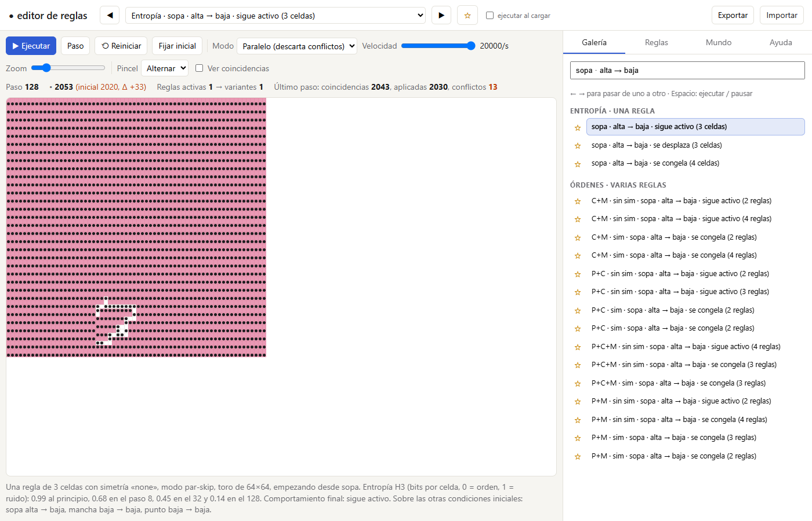

# • — editor de reglas

Editor web para experimentar con el lenguaje •. El mundo es una grilla donde cada celda tiene un • o está vacía, y todo lo demás son reglas de la forma *disposición de celdas ~> disposición de celdas*.



## Cómo abrirlo

Abre `index.html` en el navegador; no hace falta instalar nada.

Para guardar los favoritos en `favoritos.json` (y no solo en el navegador), arranca el servidor local:

```
python servidor.py 8765
```

y entra en http://localhost:8765.

## Qué permite

- Dibujar • en la grilla con el ratón.
- Crear reglas con una condición («Si») y un resultado («Entonces»), de cualquier tamaño, con celdas «cualquiera».
- Generar automáticamente rotaciones y espejos de una regla.
- Anclar reglas a una red (rectangular o diagonal) cuando la posición de los bloques no se puede deducir de los propios •.
- Ejecutar en modo secuencial o paralelo, con distintas políticas de conflicto, de 0,5 a 20.000 pasos por segundo.
- Ver las coincidencias de cada regla y comprobar si el sistema conserva el número de •.
- Recorrer la galería de autómatas con ← →, filtrarla y marcar favoritos (★).
- Rellenar la grilla con un mosaico, y exportar o importar el estado completo en JSON.



## Galería

### Hormigas

- Hormiga de Langton con bloques de 6 celdas, que conserva los •.
- Hormiga en cruces de 5 celdas, con 2 reglas y simetría de rotación, y la versión con 8 reglas de 3 celdas.
- Hormiga sin red: el mundo empieza vacío y nada está anclado.
- Hormigas autolocalizables de 4, 5, 6 y 7 celdas: reglas sin anclaje que solo encajan en la posición real. Las generó la búsqueda de `busqueda/`.

| Autolocalizable que conserva los • (5 celdas) | Cruz anclada (5 celdas) |
|---|---|
|  |  |

### Puertas lógicas

AND, OR, XOR, NAND, NOR, XNOR y NOT como reglas, y con ellas un semisumador y un sumador completo. Cada ejemplo calcula todas las combinaciones de entradas a la vez.

- Cada señal baja por un carril de 6 celdas con **doble raíl**: • en la primera celda = 0 y • en la segunda = 1. Con un solo raíl el 0 sería vacío, y NOT no tendría nada con lo que dispararse.
- Las filas alternan señales y componentes. Cada componente (puerta, copia, cruce, desplazamiento) es un patrón de • que dice qué es, y cada combinación de entradas es una regla.
- Sin red ni anclaje. Todo código empieza por «••» y en una fila de señales nunca hay dos • seguidos, así que las reglas solo encajan alineadas con un código. En horizontal, los códigos forman un código sin coma.

| Tablas de verdad (de arriba abajo AND, OR, XOR, NAND, NOR, XNOR y NOT) | Sumador completo tras 11 etapas |
|---|---|
|  |  |

### Máquinas de Turing

Suma unaria (3 + 2) y los busy beaver de 2, 3 y 4 estados. El de 4 estados escribe 13 unos en 107 pasos y para.

- Cada casilla de la cinta es una columna: marca •, símbolo, estado de la cabeza en binario y otra marca •.
- Hay una regla por transición. Lee la columna de la cabeza y la vecina, escribe el símbolo y mueve el estado.
- Sin anclaje. Las dos marcas fijan la fila, y solo la columna de la cabeza tiene estado, así que en cada paso hay exactamente una coincidencia. Al llegar al estado de parada no queda ninguna y la máquina se detiene.



### Clásicos

Gas de partículas, arena con gravedad y triángulo de Sierpinski (regla 90).


### Entropía y órdenes

Sistemas encontrados por fuerza bruta en `busqueda/entropia/` y clasificados por cómo cambia su entropía (de «baja» a «alta» y al revés) y por su comportamiento final.

- **Entropía · una regla**: el representante más corto de cada grupo.
- **Busy beaver**: para cada tamaño de regla, la que más entropía deja tras 128 pasos.
- **Órdenes · varias reglas**: sistemas de 2 a 16 reglas que mezclan reglas productivas, consumidoras y movedoras.

En rosa, las celdas que cambiaron en el último paso.




## Resultados

El informe [`informe_autolocalizacion.pdf`](informe_autolocalizacion.pdf) responde a una pregunta: ¿cuánto cuesta que la hormiga funcione sin red, es decir, que las reglas solo puedan encajar en la posición real?

| Familia | Anclada | Sin anclaje | Anclada y conserva • | Sin anclaje y conserva • |
|---|---|---|---|---|
| 10 patrones cualesquiera | 4 | 4 | 5 | 5 |
| Hormiga = un único • | 5 | 6 | 6 | 7 |

Con reglas que miran el bloque actual y el destino completos, no anclar sale gratis en general. Solo cuesta una celda si la hormiga debe ser un único •. Ojo: esto minimiza el tamaño del bloque, no el de las reglas.

## Estructura

| Ruta | Qué hay |
|---|---|
| `index.html`, `style.css`, `app.js` | Interfaz del editor |
| `engine.js` | Motor (también se usa desde Node) |
| `examples.js` | Ejemplos de la galería |
| `ganadores.js`, `sistemas.js`, `sistemas_multi.js` | Datos generados por los scripts de `busqueda/` |
| `logica.js`, `turing.js` | Puertas lógicas y máquinas de Turing: codificación, reglas y circuitos |
| `servidor.py` | Servidor local sin caché, con la API de favoritos |
| `busqueda/` | Búsqueda de codificaciones autolocalizables (Python + numpy) |
| `busqueda/hormiga/` | Hormiga con el mínimo de reglas y hormiga sin red |
| `busqueda/entropia/` | Exploración de sistemas por entropía |
| `test/` | Pruebas en Node |

## Pruebas

```
node test/test.js
node test/autolocalizables.js
node test/logica.js
node test/turing.js
```

Comprueban que las hormigas reproducen paso a paso la hormiga clásica (autopista incluida), que las autolocalizables dan una sola coincidencia por paso sin anclaje, que Sierpinski coincide con la regla 90 y que los ejemplos conservativos conservan los •. La segunda tarda unos dos minutos. Las dos últimas comprueban todas las entradas de cada circuito y cada máquina contra su simulación directa, y que ninguna regla encaja fuera de su sitio.
